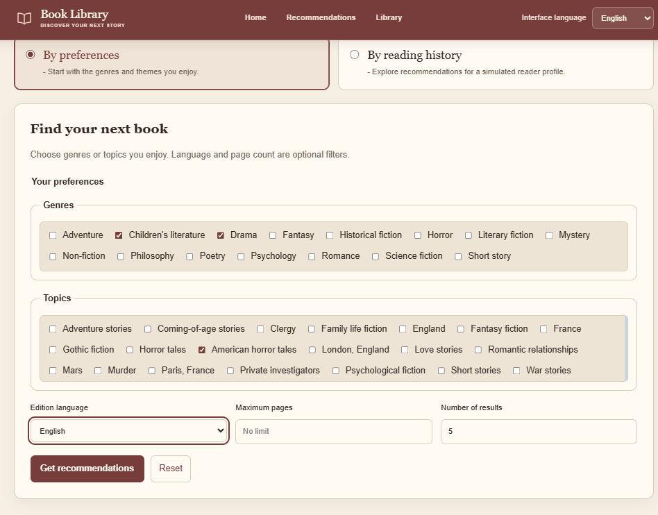
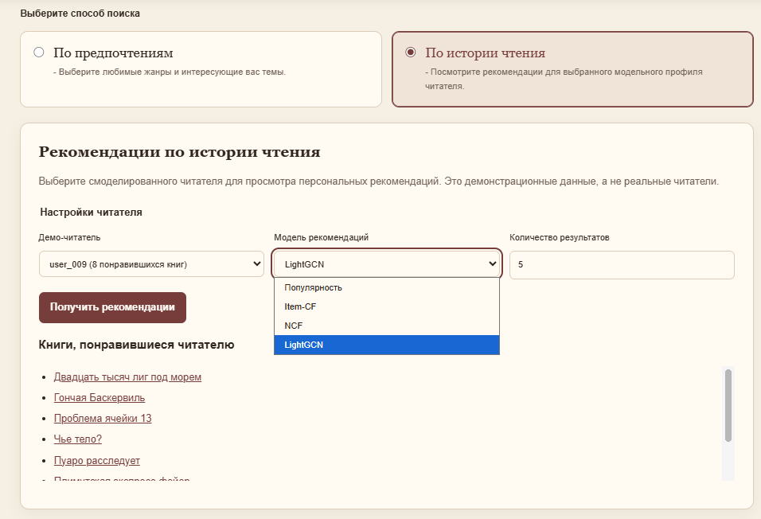

# Book Recommendation System

**Рекомендательная система для подбора книг**

A multilingual web application for book discovery and personalized recommendations, developed as an academic project at NUST MISIS.

The system combines content-based recommendation techniques with collaborative filtering and neural recommendation models. Users can discover books based on their interests, explore similar titles, or receive personalized suggestions using synthetic reading profiles.

## Features

- Search books by title or author.
- Filter by genre and sort the library.
- Browse detailed book information and related titles.
- Receive content-based recommendations with explanations.
- Explore personalized recommendations using simulated profiles.
- Compare four collaborative recommendation methods.
- Switch between English, Russian, and Vietnamese.
- Use a responsive interface with paginated results.

## Screenshots

Screenshots of the implemented application.

### Home page


### Book catalog


### Content-based recommendations


### Personalized recommendations


## Recommendation Methods

The application supports two recommendation scenarios.

### Content-based recommendations

Books are represented using TF-IDF features derived from titles, authors, genres, topics, and descriptions.

Cosine similarity is used to rank books based on selected preferences or a reference book.

The interface also displays explanations based on matching genres and topics.

### Collaborative recommendations

Four methods are implemented:

| Method | Description |
|--------|-------------|
| Popularity | Ranks books by positive interaction counts. |
| Item-CF | Uses item-item similarity derived from reading interactions. |
| NCF | Combines GMF and MLP representations of users and books. |
| LightGCN | Learns user and item embeddings through graph propagation. |

Previously liked books are excluded from personalized recommendation results.

## Dataset

The experimental dataset contains:

- **200 books**
- **1,000 synthetic reader profiles**
- **11,667 unique positive interactions**

Book metadata and user interactions are stored in JSON files.

The user-item preference matrix is sparse and can be represented in CSR format.

**Important:** User profiles and interactions are synthetic. Experimental results should not be interpreted as evidence of performance on real-world reader behavior.

## Technology Stack

| Layer | Technologies |
|-------|--------------|
| Frontend | React, TypeScript, Vite |
| Backend | Python, FastAPI, Pydantic |
| Content-based ML | scikit-learn, TF-IDF, cosine similarity |
| Collaborative ML | NumPy, SciPy, PyTorch |
| Storage | JSON and model checkpoints |
| Localization | i18next (EN / RU / VI) |
| Testing | pytest, frontend build and lint |

## System Architecture

The React frontend communicates with the FastAPI backend through HTTP requests.

The backend validates requests, retrieves data, executes the selected recommendation method, and returns ranked results.

Neural models are trained separately and loaded from saved checkpoints for inference.

No external AI API or user authentication is required.

## Getting Started

### Prerequisites

- Python 3.11
- Node.js 22.20+ (22.x) or 24.12+ (24.x)
- npm

### 1. Clone the repository

```bash
git clone <REPOSITORY_URL>
cd book-recommender-system
```

Replace `<REPOSITORY_URL>` with the actual GitHub URL.

### 2. Install backend dependencies

Windows PowerShell:

```powershell
cd backend
py -3.11 -m venv .venv
.\.venv\Scripts\python.exe -m pip install -r requirements.txt
```

### 3. Build the frontend

From the repository root:

```powershell
cd frontend
npm ci
npm run build
```

### 4. Start the application

From the frontend directory:

```powershell
cd ../backend
.\.venv\Scripts\python.exe -m uvicorn app.main:app --host 127.0.0.1 --port 8000
```

Open:

**http://127.0.0.1:8000**

The FastAPI server serves the built application and API.

### Development Mode

Run the backend and frontend in separate terminals.

Backend:

```powershell
cd backend
.\.venv\Scripts\python.exe -m uvicorn app.main:app --reload
```

Frontend:

```powershell
cd frontend
npm run dev
```

The Vite development server proxies API requests to the backend.

## Testing

Run automated backend tests:

```powershell
cd backend
.\.venv\Scripts\python.exe -m pytest -v
```

Latest locally reported result:

**48 passed, 0 failed, 1 deprecation warning**

Verify the frontend build and lint:

```powershell
cd frontend
npm run build
npm run lint
```

The backend test result does not by itself verify the experimental recommendation metrics.

## Experimental Evaluation

The collaborative methods are evaluated using:

- Precision@10
- Recall@10
- NDCG@10

Experiments use three random seeds (42, 43, 44), with approximately 60% training, 20% validation, and 20% test interactions per eligible user.

The following results are reported as mean NDCG@10 over the three experimental splits:

| Method | NDCG@10 |
|--------|---------|
| Popularity | 0.1263 |
| Item-CF | **0.1767** |
| NCF | 0.1163 |
| LightGCN | 0.1604 |

Item-CF achieved the highest average NDCG@10 in the reported experiments.

These values come from the project's experimental report and should be reproduced using the evaluation scripts before final release.

## Documentation

- [User and Administrator Guide](docs/guide.md)
- [Application Structure and API](docs/application_structure.md)
- [Collaborative Algorithms and Evaluation](docs/collaborative_algorithms.md)

## Project Information

**Academic project:** Book Recommendation System

**University:** NUST MISIS, Moscow, Russia

**Course:** Expert and Recommender Information-Analytical Systems

**Development team:** Three student contributors

## Limitations

- Synthetic interaction data rather than real reader histories.
- No authentication or persistent user-generated activity.
- No online learning from new interactions.
- Neural models require prepared checkpoints.
- Results are limited to the experimental dataset and evaluation protocol.

## Future Work

- Evaluation on real-world, appropriately licensed datasets.
- Larger catalog and more diverse interactions.
- Cold-start recommendation strategies.
- Hybrid recommendation methods.
- Additional measurements of diversity, novelty, and latency.
- User evaluation of recommendation explanations.
